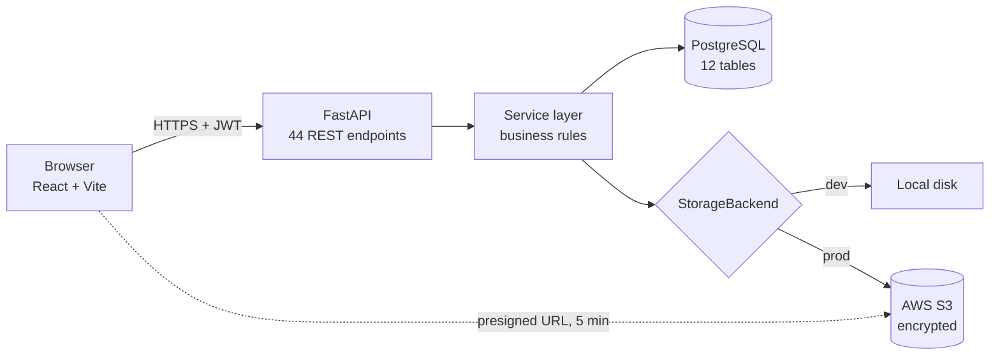

# 🏥 Hospital Management System

A full-stack hospital management platform. Patients book appointments and view their records and bills; doctors manage visits, write medical records, prescribe and order lab tests; admins oversee everything. Each role sees only the data it is allowed to see.


> **Live demo:** _coming soon_ (being redeployed)
> **API docs:** run locally and open `http://localhost:8000/docs`

---

## ✨ Features

| Role | What they can do |
|---|---|
| **Patient** | Register, book and cancel appointments, view their own medical records, prescriptions, lab results and invoices, pay invoices, upload their own documents |
| **Doctor** | Manage their own appointments (complete them, add notes), write medical records, prescribe medication, order and fill in lab tests, create invoices, upload documents for patients |
| **Admin** | Full access: manage users, deactivate accounts, view every patient, appointment and invoice |

**Highlights**
- 🔐 **JWT authentication** with bcrypt password hashing and **role-based access control** on every endpoint
- 📅 **Double-booking prevention**: the API rejects any appointment that overlaps a doctor's existing slot
- 💵 **Server-side billing**: subtotal, 8% tax and discounts are calculated on the server, and totals sent by the client are ignored
- 📄 **Encrypted medical document storage on AWS S3**: private bucket, AES-256 encryption at rest, 5-minute presigned download links
- 🛡️ **Upload validation**: checks file type, a 10 MB size limit, and magic bytes (the signature at the start of a real file), so an `.exe` can't pass as a PDF
- 🗑️ **Soft deletes**: deactivated users keep their medical history, and their old tokens stop working right away

---

## 🏗️ Architecture



The backend follows a **layered design**:

- **Routers** handle HTTP requests and permission checks.
- **Services** hold the business rules.
- **Models** are the database tables (SQLAlchemy ORM).
- **Schemas** validate data coming in and going out (Pydantic).

File storage uses the **Strategy pattern**. One interface has two backends, local disk and S3, and you switch between them with a single environment variable (`STORAGE_BACKEND`).

---

## 🧰 Tech Stack

| Layer | Technology |
|---|---|
| Frontend | React 18, Vite, Tailwind CSS, Zustand, Axios, Framer Motion, Three.js |
| Backend | FastAPI, Pydantic v2, SQLAlchemy 2.0, Uvicorn |
| Database | PostgreSQL 16 (production), SQLite (local development and tests) |
| Auth | JWT (python-jose), bcrypt (passlib) |
| Cloud | AWS S3 via boto3 (SSE-S3 encryption, SigV4 presigned URLs) |
| DevOps | Docker, Docker Compose, pgAdmin |
| Testing | pytest, FastAPI TestClient, moto (simulated AWS), pytest-cov |

---

## 🚀 Getting Started

### Option 1: Docker (recommended)
```bash
git clone https://github.com/NaimRahmanIfti/Hospital-Management-System.git
cd Hospital-Management-System
docker compose up --build
```
| Service | URL |
|---|---|
| API | http://localhost:8000 |
| Interactive API docs | http://localhost:8000/docs |
| pgAdmin (database UI) | http://localhost:5050 |

### Option 2: Run locally (uses SQLite, no Docker needed)
```bash
# Backend
python -m venv venv && source venv/bin/activate   # Windows: venv\Scripts\activate
pip install -r requirements.txt
uvicorn main:app --reload                          # → http://localhost:8000/docs

# Frontend (in a second terminal)
cd frontend
npm install
echo "VITE_API_URL=http://localhost:8000" > .env.local
npm run dev                                        # → http://localhost:5173
```

### Configuration
Settings are read from environment variables or a `.env` file (`app/core/config.py`):

| Variable | Default | Purpose |
|---|---|---|
| `DATABASE_URL` | `sqlite:///./hms_dev.db` | Database connection string |
| `SECRET_KEY` | dev value | Signs JWT tokens. **Change it in production** |
| `ACCESS_TOKEN_EXPIRE_MINUTES` | `30` | How long a login lasts |
| `STORAGE_BACKEND` | `local` | `local` or `s3` |
| `S3_BUCKET_NAME` | – | S3 bucket for documents (when `STORAGE_BACKEND=s3`) |
| `AWS_REGION` | `us-west-1` | AWS region |

AWS access keys are never stored in the code. boto3 finds credentials through the standard AWS chain: `~/.aws` on your machine, or an IAM role when running on AWS.

---

## 🧪 Testing

```bash
pip install -r requirements.txt -r requirements-dev.txt
pytest                 # 75 passed, 1 expected failure (a known open issue)
pytest --cov=app       # 90% coverage
```

The suite has **76 tests**: integration tests that call the real API, plus unit tests for the security helpers. It covers:

- login, tokens and permissions for every role
- double-booking prevention
- invoice math
- S3 storage, tested against **moto**, a simulated AWS, so tests need no AWS account and cost nothing

Writing the tests found and fixed **4 real bugs**:
- 2 endpoints that crashed the server with a 500 error
- 2 authorization holes: a doctor could write records under another doctor's name, and a patient could set a discount on their own invoice

---

## 📚 API Overview

| Area | Endpoints |
|---|---|
| Auth | `POST /auth/register`, `POST /auth/login`, `GET /auth/me` |
| Users | `GET/PATCH/DELETE /users/{id}`, `GET /users/` (admin only) |
| Patients | `GET /patients/my`, `GET/PATCH /patients/{id}` |
| Doctors | `GET /doctors/?specialization=`, `POST /doctors/`, `PATCH /doctors/{id}` |
| Appointments | `POST /appointments/`, `GET /appointments/my`, `PATCH/DELETE /appointments/{id}` |
| Medical records | `POST /medical-records/`, `GET /medical-records/my`, prescriptions, lab results |
| Invoices | `POST /invoices/`, `GET /invoices/my`, `PATCH /invoices/{id}` |
| Documents | `POST /documents/patient/{id}` (upload), `GET /documents/{id}/download` (presigned URL) |

The full interactive reference is at `/docs`, which FastAPI generates automatically.

---

## 📁 Project Structure

```
├── main.py                 # FastAPI app entry point
├── app/
│   ├── core/               # config, database, security (JWT), permissions, storage (S3)
│   ├── models/             # SQLAlchemy tables (12)
│   ├── schemas/            # Pydantic request/response models
│   ├── routers/            # API endpoints (8 routers)
│   └── services/           # business logic
├── tests/                  # pytest suite (76 tests)
├── frontend/               # React + Vite single-page app
├── docs/AWS_ROADMAP.md     # cloud deployment plan
├── Dockerfile
└── docker-compose.yml      # API + PostgreSQL + pgAdmin
```

---

## 🗺️ Roadmap

- [x] Core platform: auth, roles, appointments, records, billing
- [x] AWS S3 encrypted document storage
- [x] Automated test suite (90% coverage)
- [ ] Deploy on AWS (ECS Fargate, RDS, CloudFront), with the infrastructure written in Terraform
- [ ] CI/CD pipeline with GitHub Actions
- [ ] Restrict admin account creation to existing admins

See [`docs/AWS_ROADMAP.md`](docs/AWS_ROADMAP.md) for the full cloud plan.

---

## 👤 Author

**Naim Rahman Ifti** · [GitHub](https://github.com/NaimRahmanIfti)

Licensed under the [MIT License](LICENSE).
